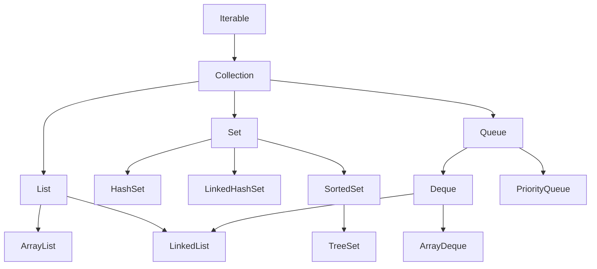

# Java Collections Framework (JCF) Overview

## 1. What is the Java Collections Framework?
The Java Collections Framework (JCF) is a unified architecture for representing and manipulating collections of objects in Java. Introduced in JDK 1.2 and significantly enhanced in modern Java (Java 8 streams, Java 21 sequenced collections), it provides:
- **Interfaces:** Abstract data types representing collections (e.g., `Collection`, `List`, `Set`, `Queue`, `Deque`).
- **Implementations:** Reusable, high-performance data structures (e.g., `ArrayList`, `LinkedList`, `HashSet`, `TreeSet`, `ArrayDeque`, `PriorityQueue`).
- **Algorithms:** Static polymorphic utility methods for sorting, searching, reversing, and synchronizing (e.g., `Collections.sort()`, `Collections.unmodifiableList()`).



## 2. Core JCF Interfaces Comparison

| Interface | Ordering Guarantee | Allows Duplicates? | Positional Access? | Primary Implementations |
| :--- | :--- | :--- | :--- | :--- |
| **`List`** | Preserves insertion order | Yes | Yes (index-based `get(i)`) | `ArrayList`, `LinkedList` |
| **`Set`** | No guarantee (unless `LinkedHashSet` or `TreeSet`) | No (Uniqueness enforced via `equals()` / `hashCode()`) | No | `HashSet`, `LinkedHashSet`, `TreeSet` |
| **`Queue`** | FIFO or Priority order | Yes | No (head inspection only) | `ArrayDeque`, `PriorityQueue`, `LinkedList` |
| **`Deque`** | Double-ended (FIFO & LIFO) | Yes | No | `ArrayDeque`, `LinkedList` |

## 3. Best Practices for Modern Java Collections
1. **Program to Interfaces:** Always declare variables and return types using the interface type:
   ```java
   List<Book> books = new ArrayList<>(); // Good
   ArrayList<Book> books = new ArrayList<>(); // Avoid
   ```
2. **Favor `ArrayDeque` over `Stack` and `LinkedList`:**
   `java.util.Stack` is legacy and synchronized; `LinkedList` incurs heavy node-allocation overhead. `ArrayDeque` is circular array-backed and cache-friendly.
3. **Set Initial Capacity:** If the collection size is known or estimable, specify initial capacity to avoid costly array resizing and copying.
