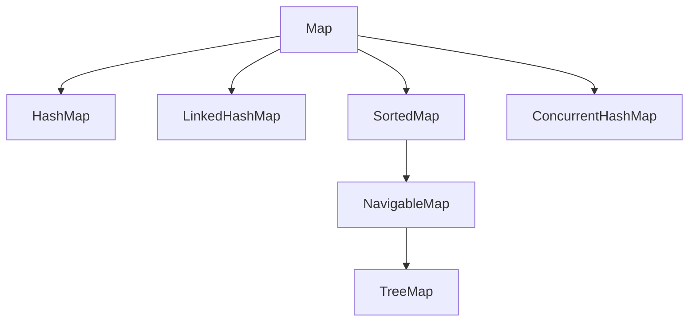

# Map Internals, Implementations, and Performance

## 1. Map Interface Architecture
Unlike `List`, `Set`, and `Queue`, `Map<K, V>` does not extend `Collection`. It models key-value associative mappings where keys are unique.



## 2. HashMap Internals (Java 8 to Java 21)
- Backed by an array of bucket nodes: `Node<K, V>[] table`.
- Default initial capacity: 16 buckets.
- Default load factor: 0.75 ($threshold = capacity \times 0.75 = 12$).
- **Bucket Index Computation:**
  ```java
  int hash = (key == null) ? 0 : (h = key.hashCode()) ^ (h >>> 16); // High-bit spreader
  int index = (n - 1) & hash; // Bitwise modulo (power of 2 sizing)
  ```
- **Collision Resolution:**
  - Chaining using singly-linked lists.
  - **Treeification:** When a bucket accumulates $\ge 8$ entries (`TREEIFY_THRESHOLD`) and table capacity $\ge 64$ (`MIN_TREEIFY_CAPACITY`), the bucket converts from a linked list into a balanced **Red-Black Tree** (`TreeNode<K, V>`).
  - Lookup complexity improves from worst-case $O(N)$ (in case of malicious or poor hashes) to guaranteed $O(\log N)$!

---

## 3. Map Implementations Comparison

| Feature | `HashMap` | `LinkedHashMap` | `TreeMap` |
| :--- | :--- | :--- | :--- |
| **Ordering** | None (Unordered) | Insertion order or Access order | Sorted by Key (Natural / `Comparator`) |
| **Data Structure** | Array + Linked List / Red-Black Tree | HashMap + Doubly-linked bucket list | Red-Black Self-Balancing Tree |
| **Lookup Time** | $O(1)$ average | $O(1)$ average | $O(\log N)$ guaranteed |
| **Null Keys** | Allowed (one) | Allowed (one) | Forbidden (if using natural ordering) |
| **Use Case** | General high-speed indexing | LRU Cache, sequential pipelines | Sorted reports, range queries (`subMap`, `tailMap`) |

---

## 4. Modern Map Methods: `Map.merge()`
The `Map.merge(key, value, remappingFunction)` method atomically combines values:
```java
// Frequency count
map.merge(department, 1, Integer::sum);

// Payroll aggregation
payrollMap.merge(department, salary, Double::sum);
```
