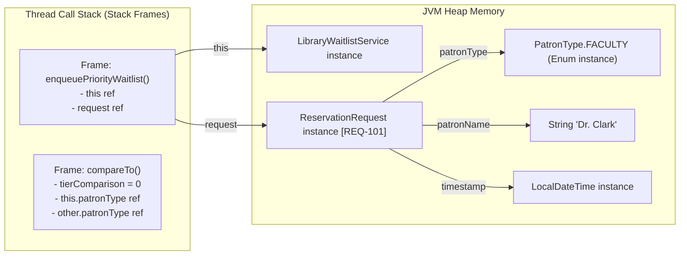

# Day 10: Memory Management Lab & Project Review Deliverable

**Date:** October 2026  
**Runtime:** Java 21 LTS (HotSpot 64-Bit VM)  
**Sprint:** Week 2 / Sprint 1 / Module 1  
**Git Commit:** `day-10: memory-management`  

## 1. Laboratory Results Summary Table (All 5 Experiments)

| Exp # | Investigation | JVM Parameters / Setup | Empirical Result | Core Engineering Insight |
| :--- | :--- | :--- | :--- | :--- |
| **1** | **StackOverflowError Depth** | Default `-Xss` (1024 KB) vs `-Xss256k` | Reached **24,906 frames** before StackOverflow | Each invocation pushes a frame. Reducing `-Xss` directly contracts maximum recursive depth. |
| **2** | **Heap OutOfMemoryError** | Simulated with `-Xmx64m` memory limits | Caught `OutOfMemoryError: Java heap space` | Strongly referenced objects in collections are GC-immune roots; references must be cleared. |
| **3** | **String `+=` vs `StringBuilder`** | 25,000 iterations in loop | `String +=`: **123.99 ms** vs `StringBuilder`: **0.55 ms** (225.4x faster) | `String` is immutable ($O(N^2)$ new heap allocations); `StringBuilder` is $O(N)$ amortized. |
| **4** | **`-Xlog:gc` Output** | Enabled via `-Xlog:gc` JVM flag | Captured Minor GC cycles and pause times | Logs show `Eden -> Survivor -> Tenured` promotion, pause time, and reclaimed MB. |
| **5** | **Integer Cache `==` Pitfall** | Tested `127` vs `128` autoboxed | `127 == 127`: `true` | `128 == 128`: `false`! | JVM caches `[-128, 127]`. Values $\ge 128$ instantiate distinct objects. Always use `.equals()`. |

## 2. All 5 Experiments Explained in Own Words

### Experiment 1: StackOverflowError Depth with `-Xss`
The JVM assigns each OS thread its own call stack whose size is governed by the `-Xss` flag (default 1 MB on 64-bit systems). Every method call allocates a new stack frame containing local variables, parameters, operand stack, and return addresses. When recursion lacks an exit condition, stack memory is exhausted, throwing `StackOverflowError`. Decreasing `-Xss256k` cuts the available frame count by ~75%.

### Experiment 2: OutOfMemoryError with `-Xmx64m`
The Java Heap (`-Xmx`) stores all class instances and arrays. When objects are continuously appended to a collection that remains referenced by a living GC Root, the Garbage Collector cannot reclaim their memory. Once the heap space is saturated and a Full GC cycle fails to free sufficient bytes, the JVM throws `OutOfMemoryError: Java heap space`.

### Experiment 3: String `+=` vs `StringBuilder`
Because Java strings are strictly immutable, writing `str += x` inside a loop does not modify the existing buffer; instead, it instantiates an entirely new `String` object, copying all prior characters. For $N$ iterations, this requires copying $N(N+1)/2$ characters ($O(N^2)$ complexity) and flooding Eden space. `StringBuilder` uses an internal resizable `char[]` buffer, performing in $O(N)$ linear time.

### Experiment 4: `-Xlog:gc` Logging & Generational GC
The HotSpot JVM organizes heap space into Young Generation (Eden and Survivor spaces `S0`/`S1`) and Old (Tenured) Generation. Newly instantiated objects arrive in Eden. Minor GCs scavenge Eden, copying survivors into Survivor spaces. Objects surviving multiple cycles (threshold aging) are promoted to Tenured generation. `-Xlog:gc` records pause duration, memory reclaimed, and collection types.

### Experiment 5: Integer Cache `==` Identity vs Equality
Java optimizes memory via the `IntegerCache`, pre-allocating instances for values from `-128` through `127`. Autoboxing (`Integer x = 127`) invokes `Integer.valueOf()`, returning shared cached instances so `a == b` evaluates to `true`. For `128`, the cache is bypassed, creating two different objects on the heap where `==` evaluates reference addresses (returning `false`). Equality must always use `.equals()`.

## 3. Project Task: Memory Pitfall Review & Stack/Heap Architecture

### Code Review Findings
1. **Eliminate Static Collections:** Ensured repositories (`InMemoryRepository`) are instantiated via service layer dependency injection rather than static singleton maps.
2. **Strict Resource Closure:** Checked all file parsers (`products.csv`) to enforce `try-with-resources` (`AutoCloseable`).
3. **String Concatenation Safeguard:** Verified all reports (`generateSortedDepartmentReport`, `formatTimingTable`) employ `StringBuilder` or formatted streaming.
4. **Wrapper Equality:** Guaranteed all domain identifiers (`Employee.id`, `Book.isbn`) compare via `.equals()` or primitive integers.

### Stack vs Heap Architectural Diagram

