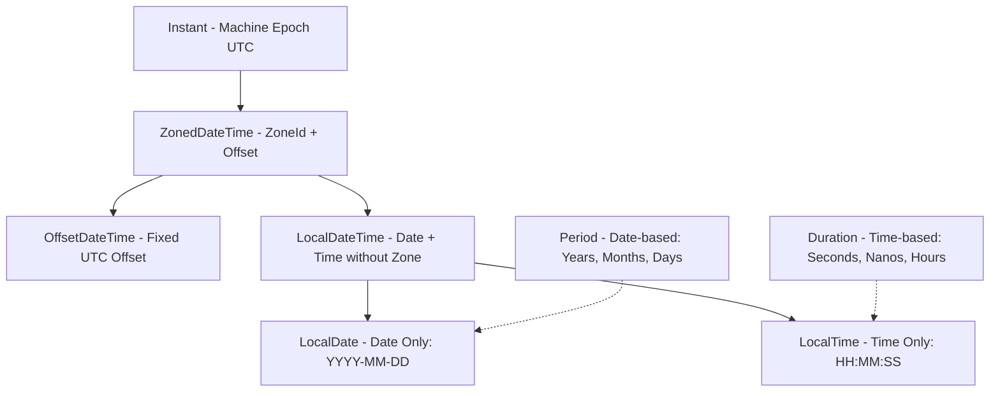

# Java Modern Date & Time API (`java.time`)

## 1. Why `java.util.Date` and `Calendar` are Obsolete
1. **Mutability:** `java.util.Date` is mutable; passing it across methods creates thread-safety vulnerabilities.
2. **Confusing Offsets:** Month index was 0-based (January was 0), years started from 1900.
3. **Thread-Unsafe Formatters:** `SimpleDateFormat` is notoriously thread-unsafe and causes corrupted dates in concurrent apps.
4. **No Timezone Separation:** `Date` actually represents an instantaneous moment in UTC epoch milliseconds, but prints in the JVM's local timezone, leading to endless confusion.

---

## 2. `java.time` Core Architecture (JSR-310)



---

## 3. Comparison Matrix: Period vs Duration
| Feature | `Period` | `Duration` |
| :--- | :--- | :--- |
| **Units** | Years, Months, Days | Seconds, Nanoseconds (Hours, Minutes, Days) |
| **Target Types** | `LocalDate` | `Instant`, `LocalTime`, `LocalDateTime` |
| **Daylight Savings Aware** | Conceptual (adds calendar days regardless of 23/25 hr days) | Exact physical time (e.g. 24 * 3600 seconds) |
| **Factory Methods** | `Period.ofDays(14)`, `Period.ofMonths(1)` | `Duration.ofHours(48)`, `Duration.ofSeconds(120)` |

---

## 4. Timezone Conversions: UTC to IST
```java
// Convert current UTC instant to Indian Standard Time (IST)
ZonedDateTime utcNow = ZonedDateTime.now(ZoneId.of("UTC"));
ZonedDateTime istNow = utcNow.withZoneSameInstant(ZoneId.of("Asia/Kolkata"));

// Formatting with DateTimeFormatter
DateTimeFormatter formatter = DateTimeFormatter.ofPattern("dd-MMM-yyyy HH:mm:ss z");
System.out.println("IST: " + istNow.format(formatter));
```
