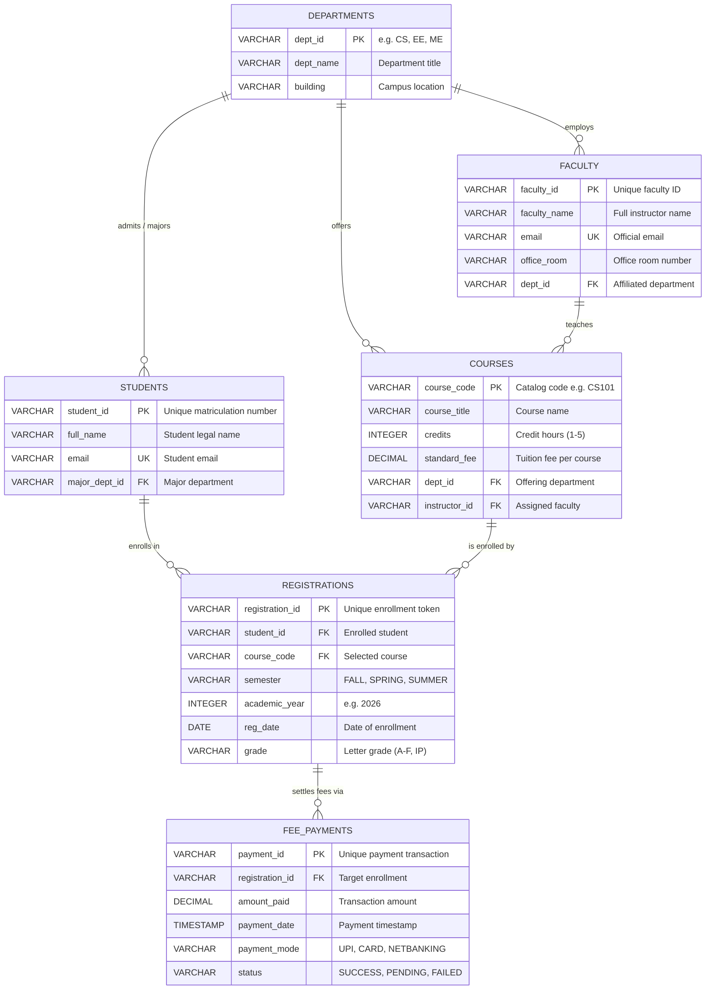

# Day 18 Deliverable: Project Entity-Relationship (ER) Diagram

## 1. Relational Architecture Diagram
The following Entity-Relationship diagram depicts the complete normalized (3NF) college registration and academic administration system with cardinalities, primary keys `[PK]`, and foreign keys `[FK]`.

---

## 2. Cardinality & Relationship Breakdown
| Relationship | Type | Cardinality | Enforced Constraints |
| :--- | :--- | :--- | :--- |
| `DEPARTMENTS` to `STUDENTS` | 1 to Many (1:N) | One department majors zero or many students. Each student must declare exactly one major department. | `FOREIGN KEY (major_dept_id) REFERENCES DEPARTMENTS(dept_id)` |
| `DEPARTMENTS` to `FACULTY` | 1 to Many (1:N) | One department employs one or many faculty members. | `FOREIGN KEY (dept_id) REFERENCES DEPARTMENTS(dept_id) ON DELETE RESTRICT` |
| `FACULTY` to `COURSES` | 1 to Many (1:N) | A faculty member instructs zero, one, or multiple courses. | `FOREIGN KEY (instructor_id) REFERENCES FACULTY(faculty_id) ON DELETE SET NULL` |
| `STUDENTS` to `COURSES` | Many to Many (M:N) | A student registers for multiple courses; a course hosts multiple students. | Resolved via junction table `REGISTRATIONS` with composite unique constraint `(student_id, course_code, semester, academic_year)`. |
| `REGISTRATIONS` to `FEE_PAYMENTS` | 1 to Many (1:N) | Each registration generates one or more installment fee payments. | `FOREIGN KEY (registration_id) REFERENCES REGISTRATIONS(registration_id) ON DELETE CASCADE` |
