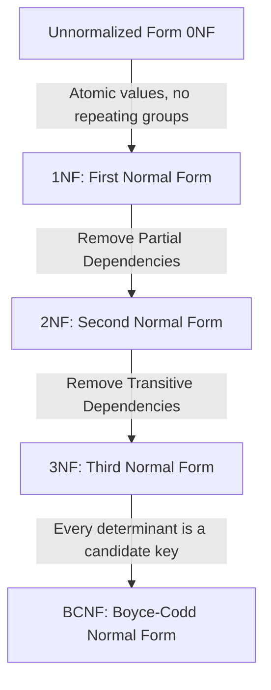

# Database Normalization Guide: 1NF to 3NF

## 1. What is Normalization?
Normalization is the process of structuring relational database tables to reduce data redundancy and improve data integrity. It follows mathematically proven rules based on **Functional Dependencies**.

---

## 2. The Normal Forms Hierarchy

---

## 3. Summary of Normal Forms
| Normal Form | Core Requirement | How to Achieve |
| :--- | :--- | :--- |
| **1NF** | Atomic attributes, defined Primary Key, no repeating arrays | Split comma-separated values into separate records; define composite PK if needed. |
| **2NF** | In 1NF + No Partial Functional Dependencies | Move attributes that depend on only part of a composite PK into their own table. |
| **3NF** | In 2NF + No Transitive Dependencies ($X \to Y \to Z$) | If a non-prime attribute depends on another non-prime attribute, extract it into a separate referenced entity. |
| **BCNF** | In 3NF + For every functional dependency $X \to Y$, $X$ must be a superkey | Decompose tables where a prime attribute is determined by a non-superkey. |
